  

# 11 October

**An Open Engineering Collective**

> Real problems. Open engineering.

11 October works on engineering problems that already exist. Problems come from people, communities, organizations, maintainers, laboratories, and other real sources. We investigate the context, build practical solutions, test them, and openly document what we learn.

## How we work

1. **01 FIND:** Start with a problem reported by a real person or source.
2. **02 VERIFY:** Check the evidence, context, and constraints.
3. **03 ENGINEER:** Build the smallest useful solution.
4. **04 TEST:** Measure what works, what fails, and under which conditions.
5. **05 OPEN:** Share the solution, reproducible materials, and an engineering article.

## Areas of work

Electronics · Embedded systems · IoT · Firmware · PCB design · Hardware · Software · Instrumentation · Automation · Edge computing · Engineering tools

These are points of interest, not boundaries. Work may cross disciplines when the problem calls for it.

## Current work

> **First problems are being identified.**

A submission is reviewed before it becomes an official problem. Existing organization repositories are linked below; a repository is not described as an accepted problem solution without a source and verification record.

## Take part

- [Submit a Problem](https://github.com/ElevenOctober/.github/issues/new?template=problem-submission.yml)
- [Explore Problems](https://github.com/ElevenOctober/.github/issues)
- [Contribute](https://github.com/ElevenOctober/.github/blob/main/CONTRIBUTING.md)
- **Read Open Engineering Articles:** coming soon; see the [article format](https://github.com/ElevenOctober/.github/blob/main/docs/OPEN_ENGINEERING_ARTICLES.md)
- [View Projects](https://github.com/orgs/ElevenOctober/repositories)

When a problem is accepted, its source and verification will be recorded. Requester attribution is deliberate, and private information does not belong in public issues or articles.
